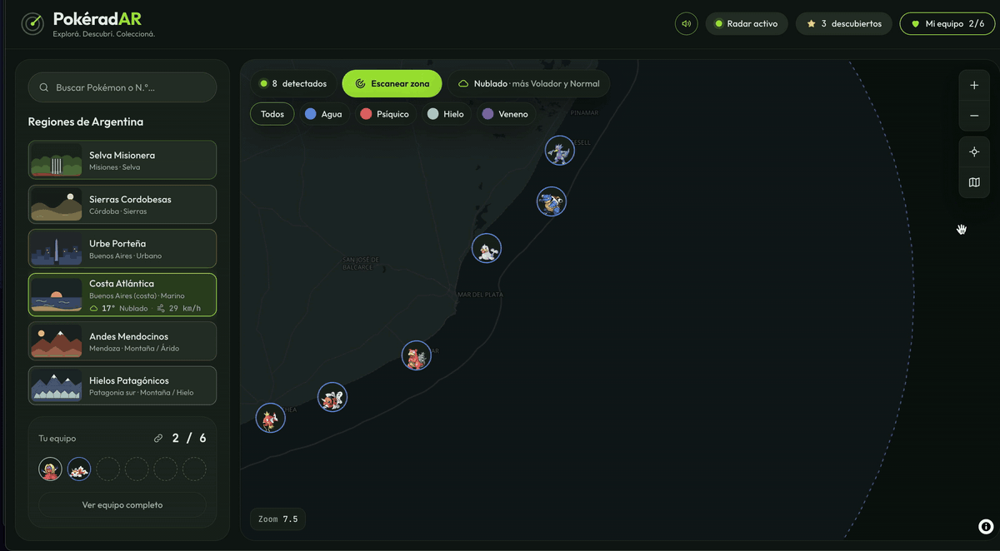

# PokéradAR 📡

**Explorá. Descubrí. Coleccioná.** Un radar de expedición Pokémon sobre el mapa de Argentina: cada región tiene su bioma, su clima real y sus propios Pokémon.

🔗 **Demo:** [pokeradar-candeferrari.vercel.app](https://pokeradar-candeferrari.vercel.app/)



| | |
|---|---|
| **Stack** | Next.js 16 (App Router) · TypeScript estricto · Tailwind CSS v4 · MapLibre GL 6 + OpenFreeMap |
| **Datos** | PokéAPI v2 · Open-Meteo (clima en tiempo real) |
| **Lighthouse** | Accesibilidad 100 · Buenas prácticas 100 · SEO 100 · CLS < 0,1 |
| **Tests** | 30 tests unitarios con Vitest sobre las reglas del radar |

---

## 1. Concepto y narrativa

La PokéAPI no dice dónde vive cada Pokémon, así que PokéradAR lo imagina con una regla coherente: **cada región argentina es un bioma, y cada bioma atrae ciertos tipos**.

| Región | Bioma | Afinidad del bioma | También aparecen |
|---|---|---|---|
| Selva Misionera | Selva | Planta, Bicho, Veneno | Volador, Fantasma, Tierra, Psíquico |
| Sierras Cordobesas | Sierras | Roca, Tierra, Planta, Lucha, Hada | Agua |
| Urbe Porteña | Urbano | Eléctrico, Normal | Volador, Hada, Acero |
| Costa Atlántica | Marino | Agua | Psíquico, Hielo, Veneno |
| Andes Mendocinos | Montaña / Árido | Tierra, Roca, Fuego | Volador |
| Hielos Patagónicos | Montaña / Hielo | Hielo, Roca, Tierra | Agua |

La **afinidad** decide a qué región va cada Pokémon. Como muchos tienen dos tipos, cada región termina con más variedad: un Slowpoke es Agua y Psíquico, así que vive en la costa y suma Psíquico a sus filtros. Los filtros del radar se calculan con esos tipos reales.

**Cómo se reparten los 151 Pokémon.** Un script (`npm run build:pokemon`) asigna cada Pokémon a una sola región: su tipo principal suma 2 puntos, el secundario 1, y gana la región con más puntos. Los empates se resuelven por familia evolutiva, para que Charmander, Charmeleon y Charizard vivan juntos. El resultado se precalcula y se guarda en `data/pokemon-regions.json`: la app no consulta 151 endpoints por visita.

**El clima real cambia lo que aparece.** El radar consulta el clima de cada región con Open-Meteo y lo traduce en una regla de juego: con lluvia aparecen más Agua y Bicho, con calor más Fuego y Tierra, con niebla más Fantasma, con viento fuerte más Volador y Dragón. El clima **inclina, no obliga**: un tipo favorecido tiene 3 veces más chances, pero el radar sigue sorprendiendo. La regla se muestra en pantalla ("Lluvia · más Agua y Bicho"), porque una mecánica que el usuario no ve no existe para él.

**El recorrido:**

1. **Explorar.** Elegís una región (desde la lista o tocándola en el mapa al alejar el zoom) y la cámara viaja hasta ella.
2. **Descubrir.** "Escanear zona" detecta 8 Pokémon que aparecen uno tras otro en puntos con sentido geográfico, elegidos a mano. Podés filtrar por tipo, buscar por nombre o número, y abrir la ficha con datos reales de la PokéAPI: estadísticas, descripción en español y su grito original.
3. **Coleccionar.** Armás tu equipo de hasta 6 Pokémon. Se guarda en el navegador junto con tus descubiertos.
4. **Compartir.** Ves tu equipo completo en un modal, sin salir del mapa, y lo compartís con un link. Quien lo recibe entra a una página con las tarjetas de tu equipo y, en WhatsApp o en redes, ve una imagen de vista previa generada para ese equipo.

**Qué aporta a la UX:**

- **El mapa es la navegación.** Alejar el zoom muestra todas las regiones con su color; tocar una viaja hacia ella.
- **Las animaciones cuentan algo.** Los Pokémon del escaneo anterior se encogen y los nuevos aparecen escalonados, así se entiende que "el radar encontró otros". El seleccionado late con pulsos de radar y la cámara lo centra sin taparlo con la ficha.
- **Sonido opcional.** Barrido de radar, un "blip" por cada Pokémon detectado, un viaje entre regiones y el grito real de cada Pokémon. Está apagado por defecto.
- **Color con significado.** El color de tipo identifica (marcadores, contornos de región, equipo) y el lima marca estado (selección, foco, radar activo).
- **Mobile pensado aparte.** El buscador queda siempre visible, los controles del mapa van en la zona del pulgar y abajo hay un único panel con prioridad: Pokémon elegido > equipo > región.
- **Dos públicos para el equipo.** Quien lo armó lo ve en un modal sobre el mapa; quien recibe el link, en una página propia (`/team/1-25-133`). Las dos vistas usan el mismo componente de tarjetas.
- **Cada estado tiene diseño:** skeletons con la estética del radar, errores con "Reintentar" y la pantalla de carga "Iniciando radar…".

---

## 2. Arquitectura y stack

### Librerías y por qué

| Librería | Para qué | Por qué esta |
|---|---|---|
| **Next.js 16 (App Router)** | Rutas, Server Components, caché | Pedido por el desafío. Uso `"use cache"` y `cacheLife` (Cache Components). |
| **TypeScript estricto** | Tipado | `strict: true` y ningún `any` en el proyecto. |
| **Tailwind CSS v4** | Estilos | Los tokens del design system viven en `@theme` y cada token es una clase (`bg-surface`, `bg-type-fire`). |
| **MapLibre GL 6 + OpenFreeMap** | Mapa vectorial | Open source y sin API key. Permite estilos data-driven (cada región pinta su color con `["get", "color"]`). |
| **Web Audio API** | Efectos de sonido | Se generan con osciladores: no hay archivos que descargar ni licencias. |
| **Vitest** | Tests unitarios | Rápido y compatible con TypeScript y el alias `@/` sin configuración extra. |
| **Animaciones CSS** (no Framer Motion) | Marcadores, ficha, barras | Todas son entradas, salidas y pulsos que CSS resuelve sin sumar peso al bundle. El mapa ya es la dependencia más pesada. Todas respetan `prefers-reduced-motion`. |

### Estructura de carpetas

```
app/
  page.tsx                  → Server Component: monta el Explorer
  loading.tsx               → skeleton de toda la pantalla
  pokemon/[id]/             → ficha con URL propia (page, loading, error, metadata)
  team/[ids]/               → equipo compartible (page, loading, opengraph-image)
  api/pokemon/[id]/         → Route Handler: PokéAPI → datos en español, cacheados
  api/weather/[region]/     → Route Handler: Open-Meteo → clima de la región
components/
  Explorer.tsx              → único dueño del estado (región, detectados, selección)
  ui/                       → piezas genéricas, sin saber de Pokémon (Icon, Pill, Tooltip, TypeChip, ErrorState)
  pokemon/                  → piezas del dominio (ficha, estadísticas, favoritos, grito)
  map/                      → mapa, marcadores, barra del radar
  layout/                   → header, sidebar, buscador, equipo
  mobile/                   → vista previa, hoja de regiones, barra inferior
lib/
  radar/                    → regiones, escaneo, clima y su regla, geometría
  pokemon/                  → PokéAPI (servidor), cliente con caché, colección, equipo
  sound/                    → efectos con Web Audio
  hooks/                    → media query, hidratación, clima por región
  tests/                    → tests unitarios (Vitest)
scripts/
  build-pokemon-regions.ts  → reparto de los 151 Pokémon por región
data/
  pokemon-regions.json      → resultado precalculado
```

**Criterio:** `ui/` es para lo que podría llevarse a otro proyecto. Un botón no va ahí por ser un botón: `FavoriteButton` conoce el equipo y el límite de 6, así que vive en `pokemon/`. La lógica sin interfaz va en `lib/`, agrupada por dominio.

### Decisiones clave

- **Servidor vs. cliente.** Las páginas y los Route Handlers son de servidor. El mapa es cliente y se carga con `dynamic(..., { ssr: false })`, porque MapLibre necesita `window`. La ficha `/pokemon/[id]` es de servidor, con dos "islas" de cliente (favoritos y descubrimiento): llega con los datos en el HTML y manda el mínimo de JavaScript.
- **Route Handlers como intermediarios.** El navegador nunca consulta servicios externos directamente. El servidor valida el id, traduce y recorta la respuesta, y la cachea (`cacheLife("days")` para la PokéAPI, unos 10 minutos para el clima). Si mañana cambia el proveedor del clima, se toca un solo archivo.
- **Dos niveles de caché.** En el servidor, compartida por todos los usuarios. En el navegador, un `Map` de promesas que hace instantáneo reabrir una ficha; si un pedido falla, se borra para que "Reintentar" funcione de verdad.
- **Estado según su naturaleza.** Los detectados son efímeros (`useState`). El equipo y los descubiertos son persistentes: un store sobre `localStorage` con `useSyncExternalStore`, sin errores de hidratación y sincronizado entre pestañas.
- **React dentro de MapLibre.** Cada marcador es un `<div>` que MapLibre posiciona, y React dibuja el `RadarMarker` adentro con `createPortal`. Así el marcador sigue siendo un componente normal.
- **Equipo compartible.** La URL `/team/1-25-133` la puede escribir cualquiera, así que `parseTeam` descarta ids inválidos, repetidos y lo que pase de 6. El archivo `opengraph-image.tsx` genera en el servidor una imagen distinta para cada equipo. El modal usa el `<dialog>` nativo, que ya resuelve el foco, la tecla Escape y la capa superior.
- **Datos derivados, no configurados.** Los filtros por tipo salen de los Pokémon que realmente viven en cada región (con un mínimo de 2 por tipo), así ningún filtro devuelve vacío.

### Rendimiento

| Lighthouse | Mobile | Desktop |
|---|---|---|
| Performance | ~37 (mediana de 3) | ~75 |
| Accesibilidad / Buenas prácticas / SEO | 100 / 100 / 100 | 100 / 100 / 100 |

El costo en performance mobile es el mapa WebGL: el chunk de MapLibre consume unos 6 s de CPU en la simulación de un celular de gama media. Lo mitigamos con un estilo de mapa aligerado (sin capas de edificios, POIs ni nombres que no aportan), `fadeDuration: 0`, `pixelRatio` limitado a 2, espacio reservado para lo que llega tarde (CLS < 0,1) y precarga del clima con `requestIdleCallback`. **Decisión consciente:** un mapa interactivo real es el núcleo de la experiencia, y no lo cambiamos por una imagen estática.

### Tests

30 tests unitarios con Vitest sobre la **lógica pura**, donde viven las reglas del juego:

| Archivo | Qué verifica |
|---|---|
| `weather-boost.test.ts` | La regla del clima y sus prioridades (la tormenta gana al calor, el viento a la temperatura, día y noche). |
| `scan.test.ts` | Que cada región detecte 8 Pokémon propios, sin repetir ni superponerse; que los filtros y la búsqueda funcionen; que ningún filtro quede vacío. |
| `regions.test.ts` | La distancia real (Haversine) y que la ubicación no fuerce una región lejana. |
| `team.test.ts` | Que una URL de equipo inválida no rompa nada. |

**Por qué estos:** son los de menor costo (sin navegador ni red) y mayor riesgo (si fallan, la app "anda" pero hace otra cosa). Varios convierten en regla bugs que ya encontramos, como la Costa Atlántica sin filtros. Los componentes y el mapa se cubrirían con Testing Library y Playwright (ver Próximos pasos).

### Correr el proyecto

```bash
npm install      # también copia el worker de MapLibre a /public (postinstall)
npm run dev
npm test         # tests unitarios
```

No hace falta ninguna variable de entorno: la PokéAPI y Open-Meteo no usan API key.

---

## 3. Uso de Inteligencia Artificial (AI-Native Workflow)

**Herramienta:** Claude, como pair programmer durante todo el proyecto.

**Cómo trabajé:**

- **Diseño primero.** Con Claude armé el design system (tokens, componentes, paleta) y los layouts de desktop y mobile antes de escribir código. El código después "alinea" con lo diseñado.
- **Escribí todo el código yo misma.** Claude proponía y explicaba; yo lo tipeaba, lo probaba y lo cuestionaba. Era la primera vez que usaba Next.js App Router y MapLibre, y quería entender cada pieza, no copiar y pegar.
- **Bitácora de aprendizaje.** Durante el proyecto registré cada decisión importante. En [`docs/bitacora.md`](docs/bitacora.md) están las 20 más relevantes: qué pasó, qué decidimos y qué aprendí.
- **Commits chicos con Conventional Commits** y ramas `develop` → `main` por Pull Request. El historial cuenta cómo se construyó la app.

### Dónde se equivocó la IA y cómo lo corregí

| Qué pasó | Cómo lo detecté | Cómo se resolvió |
|---|---|---|
| **Código para una versión vieja de MapLibre.** La IA asumió la v5 (`import maplibregl from`), pero se instaló la v6, que no tiene default export y carga su worker distinto. | Errores en consola y el mapa en blanco. Revisé la versión real en `package.json`. | `import * as maplibregl`, worker servido desde `/public` y un script `postinstall` para que no se desactualice. |
| **`Math.random()` durante el render.** El primer escaneo rompía el prerender de Next 16 (Cache Components). | Leí el stack trace: el error nacía en el render del servidor. | El primer escaneo ocurre cuando el mapa termina de cargar, no durante el render. |
| **Código truncado con "…".** La IA mostró una línea de clases abreviada y yo la pegué así. | El build falló con "Unterminated template string". | Le pedí la línea completa. Lección: nunca aceptar código abreviado. |
| **Una animación decorativa sin sentido.** Propuso un barrido verde tipo "relámpago" al escanear. | Al probarlo, no comunicaba nada y distraía. | Lo reemplazamos por la salida de los Pokémon viejos y la entrada escalonada de los nuevos. Ahora la animación cuenta qué pasó. |
| **Una regla de clima demasiado gruesa.** Cambiaba de región y siempre aparecía el mismo mensaje. | Lo noté probando varias regiones y comparé con el clima real de la API. | Sumamos temperatura y viento con prioridades explícitas, para que la mecánica se sienta viva. |
| **Sonidos que nunca sonaron.** Las funciones con sonido estaban bien escritas, pero nunca se conectaron a los botones. TypeScript no avisa porque las firmas son iguales. | Le dije que el escaneo y el cambio de región no sonaban. Buscamos dónde se usaba cada función. | Conectamos los props correctos. Lección: verificar que algo esté conectado antes de sospechar de la lógica. |
| **Filtros configurados en vez de derivados.** La Costa Atlántica no mostraba ningún filtro de tipo. | Lo vi navegando la región. | Los filtros ahora salen de los Pokémon reales de cada región, e incluyen los tipos secundarios. |
| **Prioridades sin leer la consigna.** Antes de releer los criterios del desafío, la IA propuso tests y CI como lo más urgente. | Contrasté su propuesta con la ponderación real del PDF. | Reordenamos: deploy, README y experiencia primero; los tests, cuando lo obligatorio ya estaba resuelto. |
| **Instalar sin fijar versión.** Indicó `npm install -D vitest`, que trajo la v5, incompatible con `@types/node` 20 (`ERESOLVE`). | El error de npm al instalar. | Fijamos `vitest@3` en lugar de forzar con `--force`, que esconde el conflicto. |
| **El mapa invisible.** `maplibre-gl.css` pisaba la clase `absolute` de Tailwind, sin ningún error en consola. | DevTools → Styles: la regla aparecía tachada. | Entendimos las cascade layers de Tailwind v4 y envolvimos el mapa en un contenedor propio. |

**Mi rol:** la IA acelera mucho, pero no prueba la app. Los errores más importantes los encontré usándola como usuaria: probando en el celular, cambiando de región, escuchando y mirando las métricas. Por eso cada sugerencia la verifiqué contra la documentación, la versión instalada o el comportamiento real.

También hubo decisiones de producto que salieron de usarla: sumar color porque se veía "todo verde", ver el equipo en un modal en vez de ir a otra página, o que los filtros de la Costa mostraran sus tipos secundarios.

---

## 4. Próximos pasos (con una semana más)

**Producto**

- **Progreso por región:** "12/28 descubiertos en la Costa Atlántica", con una insignia al completar cada región. Le da a la exploración un objetivo a largo plazo.
- **Pokédex de descubiertos:** los 151 en una grilla, con silueta para los que todavía no se encontraron.
- **Día y noche reales:** de noche aparecen más Fantasma y Siniestro, y el mapa se oscurece. El dato `is_day` ya llega desde Open-Meteo.
- **Pronóstico:** "Mañana llueve en la Selva Misionera: más Agua y Bicho", para planificar la expedición.
- **Sprites animados** en los marcadores y en la ficha (versiones animadas de la PokéAPI).
- **Más Pokémon al acercarse:** el zoom revela zonas más chicas con sus propios hallazgos.
- **Filtros avanzados:** por generación (hoy el radar usa la 1.ª, los 151 originales) y por rango de estadísticas.
- **Cantidad de detectados configurable** (8, 12, 16, 20), con más puntos de aparición por región.
- **Onboarding** de tres pasos la primera vez, que se pueda saltear.
- **Arrancar en la región más cercana sin pedir permiso:** Vercel informa la ciudad aproximada del visitante según su conexión (`x-vercel-ip-latitude`). Con eso el radar podría abrir directamente en la región más cercana, sin el cartel de permiso de ubicación.

**Accesibilidad**

- **Modo claro** y contraste alto, respetando `prefers-color-scheme` y `prefers-contrast`.

**Técnica**

- **Más tests:** componentes con Testing Library y un e2e con Playwright del recorrido principal (explorar, escanear, sumar al equipo, compartir).
- **CI** con GitHub Actions: lint, tipos, tests y build en cada PR.
- **Performance mobile:** cargar el mapa después de la primera interacción o con una vista previa estática, y medir con PageSpeed Insights en producción.
- **Zonas como polígonos reales** de cada bioma en lugar de círculos.
- **PWA** con el equipo disponible offline.
- **Sincronizar el equipo entre dispositivos** con una cuenta (hoy vive en `localStorage`).

---

Hecho por **Candelaria Ferrari** · Desafío técnico Frontend Engineer (Junior) · DataInt
